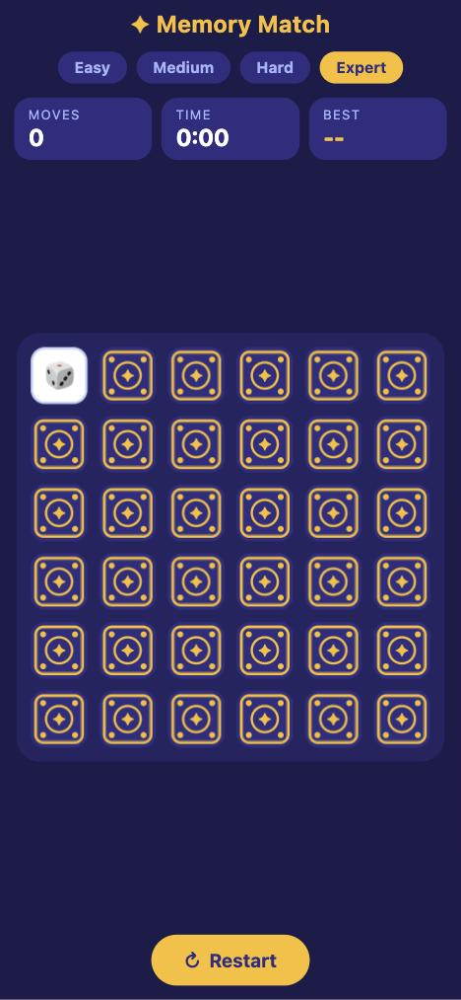
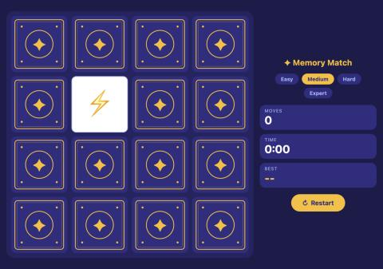

# Memory Match

A card-matching memory game built with Expo and React Native. A grid of face-down cards hides pairs of matching symbols. Flip two cards per turn: matches stay face up, mismatches flip back. Clear the board in as few moves and as little time as you can. Best scores are saved on the device.

Single player, fully offline, no backend.

| Portrait (Expert, 6×6) | Wide layout (Medium, 4×4) |
| --- | --- |
|  |  |

## Features

- **Four difficulty levels:** Easy 3×4, Medium 4×4, Hard 4×5 and Expert 6×6. Your last choice is remembered.
- **Best scores per level**, stored locally: fewest moves wins, with time as the tiebreaker. A "New best!" badge appears on the win screen.
- **Animations** (Reanimated): 3D card flip, match pulse, mismatch shake and an animated win screen. They respect the system "Reduce Motion" setting.
- **Haptics** for flips, matches, mismatches and wins (iOS and Android; skipped on web).
- **Responsive layout:** a single column on phones, and a board-plus-side-panel layout on wide windows such as tablets or the open iPhone Duo.
- **Accessibility:** cards are announced by position and name ("Card 5, apple"), matches, mismatches and wins are announced, and the win dialog is modal for VoiceOver and TalkBack.
- **Dark and light** system themes.

## Getting started

Requirements: Node 22 or newer and npm.

```bash
npm install
npx expo start
```

Then press `w` for the web build, or scan the QR code for a native build.

### Native builds (development build)

This project uses Expo SDK 58, which is newer than the Expo Go app in the stores, so run it as a development build:

```bash
npx expo run:ios      # needs Xcode
npx expo run:android  # needs Android Studio
```

On iOS, CocoaPods needs a UTF-8 locale. If the build fails with an `Encoding::CompatibilityError` from `pod`, set one first:

```bash
export LANG=en_US.UTF-8 LC_ALL=en_US.UTF-8
```

`ios/` and `android/` are generated (Continuous Native Generation) and git-ignored. Native settings live in `app.json` and config plugins.

## Scripts

| Command | What it does |
| --- | --- |
| `npm start` | Start the Expo dev server |
| `npm run web` | Start the web build |
| `npm run ios` / `npm run android` | Start for a simulator or emulator |
| `npm test` | Run the Jest test suite (`jest-expo`) |
| `npm run typecheck` | Type-check with `tsc --noEmit` |
| `npm run lint` | Lint with `expo lint` |

CI (`.github/workflows/ci.yml`) runs lint, typecheck and tests on every push to `main` and every pull request.

## Project structure

```
src/
  app/            Expo Router routes (index.tsx renders the game)
  components/     GameScreen, Board, CardView, StatsBar, DifficultyPicker, WinModal
  hooks/
    useMemoryGame.ts   game state, timers, best scores, haptics and announcements
  lib/
    gameReducer.ts     pure game rules (FLIP, RESOLVE, TICK, RESTART)
    shuffle.ts         Fisher-Yates shuffle and deck building
    difficulty.ts      difficulty levels
    symbols.ts         card symbols and their spoken names
    storage.ts         AsyncStorage helpers for best scores and difficulty
    theme.ts           light and dark palettes
```

The game rules are a plain reducer in `src/lib/gameReducer.ts`, so they are easy to test without rendering anything. The hook adds the side effects around it: the mismatch delay, the timer, persistence, haptics and screen-reader announcements.

## Testing

```bash
npm test
```

The suite covers the reducer, deck building and shuffling, storage (including corrupt data and failing storage), difficulty levels, and the `useMemoryGame` hook (timers, mismatch delay, best scores, difficulty persistence, and single-fire haptics).

## Building and releasing

EAS profiles are in `eas.json` (`development`, `preview`, `production`):

```bash
npx eas-cli@latest build --profile preview --platform all
```

Before a store release, replace the bundle identifier and Android package in `app.json` (currently `com.bhimanshukalra.memorymatch`) if you want a different one. Store identifiers cannot be changed once published.

## Background

`MVP.md` is the original one-day build guide and `plan.md` is the phased plan this app was built from.
